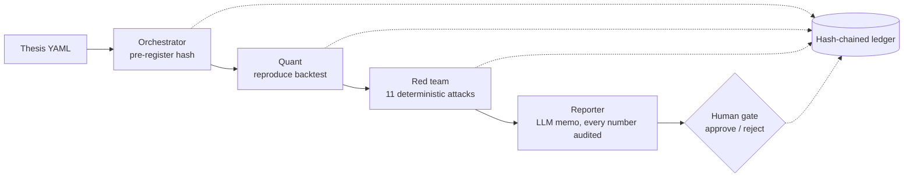
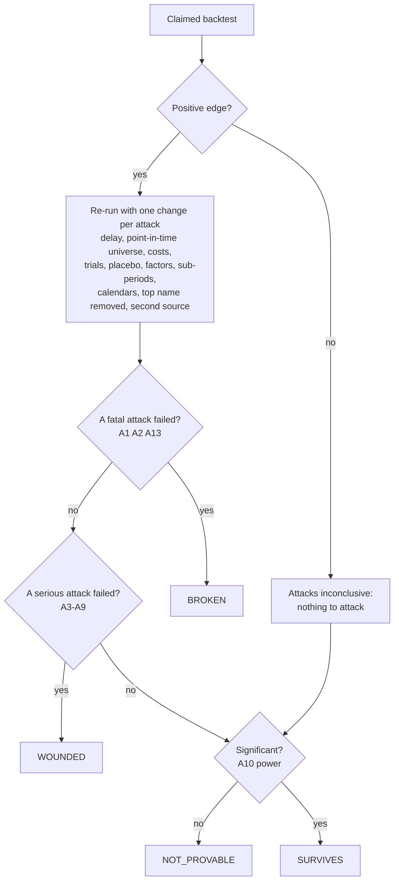
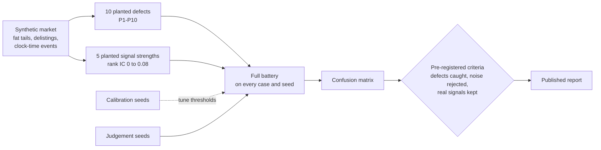

# Quantitative Multi-Agent System

A multi-agent research desk that tries to **break** quantitative trading hypotheses before anyone trusts
them. A deterministic red team attacks each backtest; language-model agents explain the verdict; a person
makes the decision; everything is written to a tamper-evident ledger.

**Language models propose and explain. Deterministic code decides. A person approves.**

> **Status: v0.1.0 (MVP).** Runs fully offline on a synthetic market with planted defects and signals.
> The red team's error rates are measured and published ([E1 results](docs/research/e1-results.md)).
> Real market data is the next step ([roadmap](docs/research/roadmap.md)).

## Why

Most backtests that look good are wrong in a few predictable ways: look-ahead leakage, survivorship bias,
ignored trading costs, a lucky period, a lucky rebalancing day, one name doing all the work, a bad price,
a market bet in disguise, and above all trying many ideas and reporting only the best one. This project
turns each of those failure modes into an automated attack and then asks the uncomfortable question:
**how often does the red team itself get it wrong?**

## Results: how good is the red team?

The red team is tested on cases whose truth is known: ten planted defects (look-ahead, survivorship,
costs, selection among 200 noise signals, a single-name jump, a time-zone error, a bad price, a
regime-limited signal, a single-calendar signal, a disguised market bet) and five planted signal
strengths, five seeds each. Thresholds were tuned on calibration seeds; the criteria were fixed before
the run; the result below is on judgement seeds that nothing was tuned on.

| Criterion | Target | Result |
|---|---|---|
| Planted defects caught | at least 95 % | **46 / 47 (98 %)** |
| Pure noise accepted as an edge | at most 10 % | **0 / 5 (0 %)** |
| Detectable real signals accepted | at least 80 % | **9 / 10 (90 %)** |

Every case, the run history and what the red team still gets wrong:
[docs/research/e1-results.md](docs/research/e1-results.md).

## How it works

### 1. The agent flow: one thesis through the desk



- **Orchestrator.** A fixed LangGraph state machine; no model chooses the next step
  ([ADR 0002](docs/decisions/0002-llms-propose-code-decides.md)). It writes the thesis hash to the ledger
  before any backtest (pre-registration).
- **Quant.** Re-runs the claimed strategy with a cross-sectional backtest engine and records the trial.
- **Red team.** Eleven attacks, each re-running the claim with one change or computing one statistic.
  The verdict is `BROKEN`, `WOUNDED`, `NOT_PROVABLE` or `SURVIVES`.
- **Reporter.** Writes the memo with OpenAI, Anthropic, xAI or any OpenAI-compatible model. A memo that
  quotes a number not found in the evidence is replaced by a deterministic one.
- **Human gate.** The run pauses (and survives a restart) until a person approves or rejects. The
  decision goes to the ledger.

### 2. The red-team flow: from attacks to a verdict



### 3. The evaluation flow: how the red team itself is tested (E1)



The red-team battery, with the textbook methods behind each attack:

| ID | Attack | Method |
|---|---|---|
| A1 | Look-ahead leakage | Trade one day later; a real edge loses little, a leak loses everything |
| A2 | Survivorship | Re-run on the point-in-time universe, delisted names included |
| A3 | Costs | Volatility-dependent costs per name |
| A4 | Selection bias | Deflated Sharpe ratio (Bailey and López de Prado, 2014); probability of backtest overfitting, CSCV (Bailey et al., 2017) |
| A5 | Placebo | 200 runs on the signal shuffled across names |
| A6 | Factor exposure | Market regression, alpha t statistic with Newey-West errors |
| A7 | Regime | Share of the PnL earned in the best of three sub-periods |
| A8 | Calendar | Every other rebalancing day of the cycle |
| A9 | Concentration | Remove the top-contributing name |
| A10 | Power | Probabilistic Sharpe ratio, minimum track record length, minimum detectable Sharpe |
| A13 | Second price source | Re-run on an independent price feed |

More detail: [architecture](docs/architecture.md), [governance rules](docs/rules.md),
[methodology](docs/research/methodology.md).

## Requirements

- Python 3.12 or later and [uv](https://docs.astral.sh/uv/), or Docker with Compose v2.
- No API key: without one, the LLM runs in simulated mode.

## Setup

```bash
git clone https://github.com/aduenasdev/quantitative-multi-agent-system.git
cd quantitative-multi-agent-system
uv sync --locked
cp .env.example .env        # optional; every variable has a safe default
uv run qmas --version
```

## Configuration

Every variable is optional. The full list, with comments, is in [.env.example](.env.example).

| Variable | Default | Description |
|---|---|---|
| `QMAS_DATA_DIR` | `<repo>/data` | Ledger, checkpoints, LLM cache and reports |
| `QMAS_LOG_LEVEL` | `INFO` | Logging level |
| `QMAS_SEED` | `20260929` | Base random seed |
| `QMAS_LLM_PROVIDER` | `simulated` | `simulated`, `openai`, `anthropic`, `xai` or `openai_compatible` |
| `QMAS_LLM_MODEL` | empty | Model id; required unless simulated (for example `claude-opus-5-5`) |
| `OPENAI_API_KEY` | empty | OpenAI (GPT) key |
| `ANTHROPIC_API_KEY` | empty | Anthropic (Claude) key |
| `XAI_API_KEY` | empty | xAI (Grok) key; endpoint `https://api.x.ai/v1` |
| `QMAS_LLM_BASE_URL`, `QMAS_LLM_API_KEY` | empty | Any OpenAI-compatible endpoint (OpenRouter, OpenCode Zen, a local server) |
| `QMAS_LLM_INPUT_USD_PER_MTOK`, `QMAS_LLM_OUTPUT_USD_PER_MTOK` | `4.0`, `20.0` | Prices of your model, per million tokens |
| `QMAS_LLM_RUN_BUDGET_USD`, `QMAS_LLM_MONTHLY_BUDGET_USD` | `0.50`, `20.0` | Spending caps; past them the LLM answers in simulated mode |
| `QMAS_LLM_CACHE` | `true` | Exact cache: the same request is never paid twice |
| `ALPACA_API_KEY_ID`, `ALPACA_API_SECRET_KEY`, `ALPACA_DATA_FEED` | empty, `iex` | Market data (planned, not read by v0.1) |
| `EDGAR_USER_AGENT` | empty | SEC EDGAR contact header (planned, not read by v0.1) |

Example, Anthropic:

```bash
QMAS_LLM_PROVIDER=anthropic
QMAS_LLM_MODEL=claude-opus-5-5
ANTHROPIC_API_KEY=...
```

## Usage

```bash
# Evaluate the red team (E1): a 1-minute smoke run, or the full run (about 5 minutes on 8 cores)
uv run qmas evaluate e1 --quick
uv run qmas evaluate e1 --split judgement

# Take one thesis through the desk
uv run qmas thesis validate examples/theses/planted-momentum.yaml
uv run qmas thesis run examples/theses/planted-momentum.yaml
uv run qmas thesis status planted-momentum-v1
uv run qmas thesis approve planted-momentum-v1 --note "sign and size look right"
uv run qmas ledger verify
```

Example output of `qmas thesis run`:

```text
planted-momentum-v1: registering, backtesting and running the red team...
verdict: SURVIVES

## Planted cross-sectional signal on the synthetic market: SURVIVES

Claimed annualised Sharpe ratio: 0.72.

Passed: A1, A2, A3, A4, A5, A10, A6, A7, A8, A9, A13. Inconclusive: none.

Surviving the battery is not proof of an edge: it only means no known defect was found. The holdout
window and a forward record still have to confirm it.

awaiting a decision: qmas thesis approve planted-momentum-v1 | qmas thesis reject planted-momentum-v1
```

A thesis is a YAML file: hypothesis, data, signal (chosen by name from a registry, never code),
portfolio, horizon, rebalancing, design and holdout windows, costs and pass thresholds. See
[examples/theses/planted-momentum.yaml](examples/theses/planted-momentum.yaml).

## Docker

**Local development** ([compose.yml](compose.yml)): every dependency, the source bind-mounted.

```bash
docker compose build
docker compose run --rm dev poe check                     # lint, types, tests, repository check
docker compose run --rm dev qmas evaluate e1 --quick
```

**Production** ([compose.prod.yml](compose.prod.yml)): a slim image with no dev tools and no source. It
runs as a non-root user on a read-only file system, with all capabilities dropped. State lives in the
named volume `qmas-data`. Each command is a one-off job.

```bash
docker compose -f compose.prod.yml build
docker compose -f compose.prod.yml run --rm qmas evaluate e1 --quick
docker compose -f compose.prod.yml run --rm qmas thesis run examples/theses/planted-momentum.yaml
docker compose -f compose.prod.yml run --rm qmas thesis approve planted-momentum-v1
docker compose -f compose.prod.yml run --rm qmas ledger verify
```

API keys reach the containers through `.env` (`env_file`); they are never baked into the image.

## Data sources

v0.1 uses only the synthetic market. Real data is planned with Alpaca as the primary source and a free
alternative for each need:

| Need | Recommended | Free alternative |
|---|---|---|
| US equity daily bars | [Alpaca Market Data](https://docs.alpaca.markets/docs/about-market-data-api), Algo Trader Plus (USD 99/month, all US exchanges) | Alpaca Basic (free: IEX real time, history since 2016 except the latest 15 minutes) |
| Survivorship-free history (delisted names) | A point-in-time vendor such as Norgate Data | Not fully available for free; Alpaca does not document delisted coverage |
| Fundamentals | A paid fundamentals API | [SEC Financial Statement Data Sets and XBRL frames](https://www.sec.gov/dera/data/financial-statement-data-sets) |
| Insider trades and 13F holdings | SEC EDGAR (official, free) | Same |
| Short interest and short volume | FINRA (free) | Same |
| Factor returns | [Kenneth French Data Library](https://mba.tuck.dartmouth.edu/pages/faculty/ken.french/data_library.html) (free) | Same |
| Crypto | Alpaca crypto data (free) | [Binance public data](https://data.binance.vision/) (free, full daily history) |
| News | Alpaca News API (check its licence before sending text to third-party LLMs) | SEC 8-K filings |

Licensed data is never committed or redistributed (`RULE-DATA-01`); users fetch their own.

## Tests and checks

```bash
uv run poe check      # ruff, ruff format, mypy --strict, pytest (coverage >= 85 %, network blocked), repository check
uv run poe secrets    # gitleaks over the history and the working tree
```

224 tests, coverage above 99 %. Statistical code is tested on analytical special cases, Monte Carlo
properties and invariants. The repository check keeps the code English-only and rejects data files and
`.env`.

## Project structure

```text
src/qmas/
  agents/       LangGraph desk: orchestrator, quant, red team, reporter, human gate
  red_team/     the battery (part_one: A1-A5, A10; part_two: A6-A9, A13) and its thresholds
  evaluation/   E1 case library, criteria and report
  backtest/     cross-sectional overlapping-portfolio engine
  market/       synthetic market and signal registry (including the planted defects)
  stats/        PSR, DSR, MinTRL, PBO (CSCV), block bootstrap, Benjamini-Hochberg, rank IC, purged k-fold
  llm/          providers, exact cache, budgets, hash-locked prompts, number audit
  prompts/      reporter prompts and their lock file
  contracts/    thesis and verdict models
  ledger.py     hash-chained ledger
docs/           rules, architecture, ADRs, specs, research notes
```

Built spec by spec: [docs/specs/INDEX.md](docs/specs/INDEX.md). Decisions:
[docs/decisions/](docs/decisions/). Rules for contributors: [AGENTS.md](AGENTS.md).

## Known limitations

- The synthetic half of the evaluation only: known nulls, validated strategies and real bugs on real data
  need data that cannot be redistributed.
- A one-day delay cannot separate look-ahead from a real edge that decays within a day (A1).
- Weak signals (planted rank IC of 0.02 or less) are mostly `NOT_PROVABLE` on six years of data. This is
  the price of letting no noise through.
- Correction rounds and the single opening of the holdout window are not implemented yet.
- Weights are held constant inside a holding period; costs are linear; no borrow costs.

## Disclaimer

Research software for education. It is not investment advice and does not trade.

## License

[MIT](LICENSE). Author: Alejandro Dueñas.
