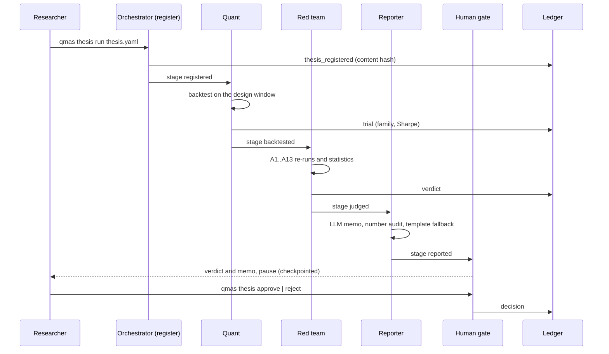
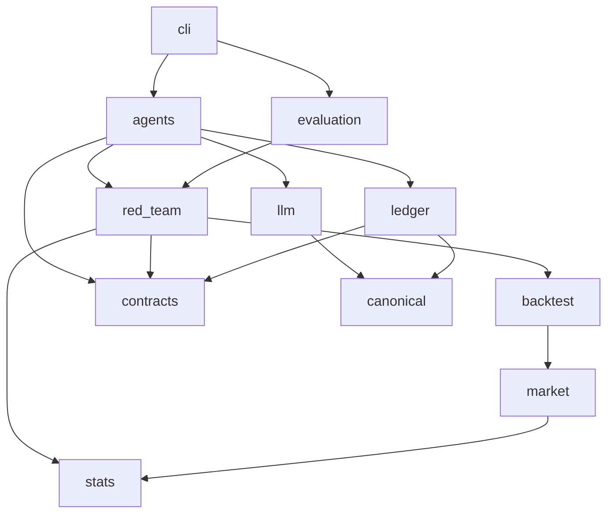

# Architecture

## Flow of one thesis

Routing is fixed. Each node checks the stage it expects and raises `IllegalTransitionError` otherwise. The
graph state is JSON-friendly and checkpointed in SQLite, keyed by the thesis key, so a paused thesis can
be decided from another process.

## Modules

| Module | Responsibility | Depends on nothing but |
|---|---|---|
| `stats` | Textbook statistics, pure NumPy/SciPy | NumPy, SciPy |
| `market` | Synthetic market and signal registry | `stats` (none at run time) |
| `backtest` | Overlapping-portfolio engine, one switch per attack | `market` |
| `red_team` | Attacks, thresholds, verdict aggregation | `backtest`, `stats`, `contracts` |
| `evaluation` | E1 case library, criteria, report | `red_team` |
| `llm` | Providers, cache, budgets, prompts, number audit | provider SDKs |
| `agents` | LangGraph desk | all of the above |
| `ledger` | Hash-chained JSON Lines ledger | `contracts`, `canonical` |

## Design choices

- **Deterministic verdicts** ([ADR 0002](decisions/0002-llms-propose-code-decides.md)). The LLM layer
  never sees the decision path; with `QMAS_LLM_PROVIDER=simulated` the whole system is reproducible
  from a seed.
- **Attacks as switches.** Every attack is "run the claim again with one thing changed" (a day of delay,
  the point-in-time universe, realistic costs, another price source, another calendar, a name removed),
  so a failure points to one weakness.
- **Planted truth.** The synthetic market plants signals of known rank IC and the ten defects of the
  evaluation plan, so the red team's own error rates can be measured (E1).
- **Tamper evidence.** Each ledger line carries the hash of the previous one; `qmas ledger verify` finds
  any edit, deletion, insertion or reordering.
- **Supply-chain care** ([ADR 0004](decisions/0004-uv-with-locked-hashes.md)). Exact pins and a hashed
  lock file; no LLM gateway library between the code and the provider SDKs.
